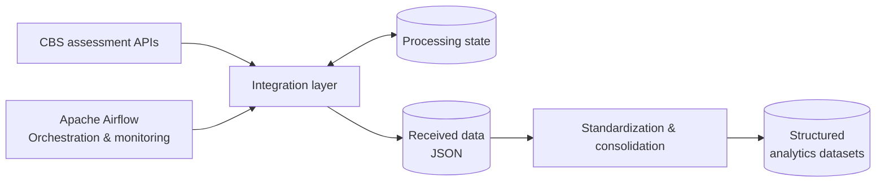

# CBS API Data Pipeline
### Data engineering for Brazil's tax reform

**Technical portfolio | Python · Apache Airflow · Docker · REST APIs · ETL**

[Português](README.md) · [Architecture overview (PT-BR)](docs/arquitetura.md)

> **Architecture showcase.** This public repository presents the technical architecture, scope and engineering capabilities of the project. The operational implementation and source code are kept private.

## Overview

**CBS API Data Pipeline** is a data engineering solution designed around integrations with Brazil's Contribution on Goods and Services (CBS) assessment services.

The core engineering challenge is to turn asynchronous tax-data acquisition into a **traceable, recoverable and analytics-ready workflow**, while accounting for external dependencies, changing processing states and data integrity.

This portfolio showcases the solution at an architectural level. It does not publish internal routines, credentials, tax records or executable artifacts.

## High-level architecture

This is a **conceptual diagram**, not a disclosure of internal implementation details.

## Engineering capabilities

| Area | Demonstrated approach |
| --- | --- |
| API integration | Working with asynchronous data processing services |
| Orchestration | Coordinating and monitoring workflows with Apache Airflow |
| Reliability | Managing recoverability and controlled failure handling |
| Data engineering | Retaining source records and producing structured outputs |
| Traceability | Making processing stages and outcomes observable |
| Reproducibility | Organizing components and dependencies using Docker |
| Quality assurance | Testing against simulated data and scenarios |

## Technology stack

**Python** · **Apache Airflow** · **Docker / Docker Compose** · **PostgreSQL** · **SQLite** · **pandas** · **HTTP/REST** · **JSON / CSV** · **GitHub Actions**

These tools describe the technology stack demonstrated by the portfolio. Internal configurations and integration logic are not publicly distributed.

## Scope and next steps

The architecture covers ingestion, processing-state tracking and preparation of CBS assessment information, including debit and credit workflows. Operational evolution and further integrations are maintained privately.

This repository is **not a publicly deployed service, a runnable distribution, or a source of actual taxpayer data**.

## About

A technical portfolio project by **Abimael Brilhante**, focused on data engineering, systems integration, process automation and Brazilian tax-domain expertise.

*Independent project; not affiliated with the Brazilian Federal Revenue Service or SERPRO.*

© 2026 Abimael Brilhante. All rights reserved. Publication of this documentation does not grant permission to reproduce or commercially exploit the private implementation.
