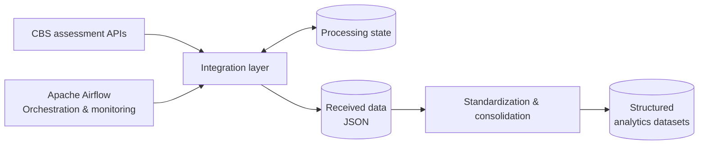

# CBS API Data Pipeline
### Data engineering for Brazil's tax reform

**Technical portfolio | Python · Apache Airflow · Docker · REST APIs · ETL**

[Português](README.md) · [Architecture overview (PT-BR)](docs/arquitetura.md)

> This repository presents the solution's architecture, technologies and key engineering aspects. The version used in production is maintained in a private repository because it contains sensitive data.

## Overview

**CBS API Data Pipeline** is a data engineering solution designed around integrations with Brazil's Contribution on Goods and Services (CBS) assessment services.

The core engineering challenge is to turn asynchronous tax-data acquisition into a **traceable, recoverable and analytics-ready workflow**, while accounting for external dependencies, changing processing states and data integrity.

## High-level architecture

## Engineering capabilities

| Area | Demonstrated approach |
| --- | --- |
| API integration | Working with asynchronous data processing services |
| Orchestration | Coordinating and monitoring workflows with Apache Airflow |
| Reliability | Managing recoverability and controlled failure handling |
| Data engineering | Retaining source records and producing structured outputs |
| Traceability | Making processing stages and outcomes observable |
| Reproducibility | Organizing components and dependencies using Docker |
| Quality assurance | Testing against simulated data and scenarios |

## Technology stack

**Python** · **Apache Airflow** · **Docker / Docker Compose** · **PostgreSQL** · **SQLite** · **pandas** · **HTTP/REST** · **JSON / CSV** · **GitHub Actions**

## Scope and next steps

The solution covers ingestion, processing-state tracking and preparation of CBS assessment information, including debit and credit workflows.

## About

A technical portfolio project by **Abimael Brilhante**, focused on data engineering, systems integration, process automation and Brazilian tax-domain expertise.
