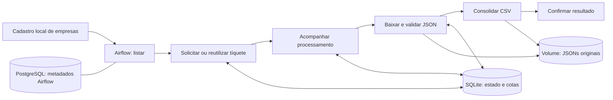

# CBS API Pipeline — Python, Airflow e Docker

Pipeline de engenharia de dados para APIs assíncronas: solicita uma extração, acompanha seu processamento por tíquete, preserva o JSON recebido e consolida dados em CSV. O projeto usa a API de apuração CBS V2 como caso de integração.

**Portfólio de Abimael Brilhante.** Esta edição contém código, testes e exemplos fictícios. Não inclui credenciais, empresas reais, arquivos fiscais, logs operacionais ou histórico de instalações anteriores. Não é um produto oficial da Receita Federal.

## O problema

Uma API com processamento assíncrono e cotas restritas exige mais do que um script agendado. Se a aplicação cair depois de abrir um pedido, repetir a abertura pode gastar cota ou perder a continuidade da coleta. Também é necessário separar uma falha de transporte de um resultado ainda em processamento.

Este projeto mantém estado persistente por empresa e endpoint para retomar solicitações existentes, controlar tentativas e tornar as falhas visíveis no Airflow.

## Arquitetura



| Camada | Tecnologia / responsabilidade |
| --- | --- |
| Extração | Python + requests; autenticação, solicitação, situação e download |
| Orquestração | Apache Airflow 3.1.8, LocalExecutor e tarefas mapeadas por empresa/endpoint |
| Estado da aplicação | SQLite; tíquetes, arquivos, cotas, bloqueios e espera compartilhada |
| Metadados da orquestração | PostgreSQL 16.13 |
| Transformação | pandas; CSVs históricos de débitos e créditos |
| Ambiente reproduzível | Docker, Python 3.12 e Docker Compose |
| Proteção de tokens | Cache compartilhado criptografado com Fernet |

## Decisões de engenharia

- **Recuperação por tíquete:** uma execução interrompida reaproveita o pedido persistido.
- **POST sem repetição automática:** respostas ambíguas exigem reconciliação antes de outra abertura.
- **Controle de consumo:** contador conservador por credencial/API/dia e espaçamento entre chamadas.
- **Tratamento de 429:** interpreta `Retry-After` em segundos ou data HTTP e persiste uma espera compartilhada. Sem prazo válido, usa o intervalo de polling como precaução local.
- **Persistência atômica:** grava arquivos temporários, substitui o destino atomicamente e registra SHA-256.
- **Validação de identidade:** aceita NI de oito dígitos ou CNPJ de 14 dígitos com a mesma raiz; preserva o campo original e rejeita outras raízes.
- **Falha visível:** consolidar os arquivos disponíveis não transforma uma coleta incompleta em sucesso geral.
- **Operação manual por padrão:** `schedule=None`, `catchup=False`, uma execução e uma tarefa ativa por vez.

## Escopo implementado

| Endpoint | Extração JSON | Consolidação CSV |
| --- | --- | --- |
| Débitos | Implementada | Implementada |
| Créditos | Implementada | Implementada |
| Pagamentos | Implementada; depende da disponibilidade/permissão do serviço | Não implementada |
| Recolhimentos | Implementada; depende da disponibilidade/permissão do serviço | Não implementada |

O CSV é um histórico dos registros recebidos, não uma tabela pronta de saldo atual. Integração com Snowflake, modelagem de estado atual e alertas externos ficam como evolução futura.

## Testar sem credenciais e sem consultar a Receita

Com Docker instalado, execute na raiz do repositório:

```sh
docker build -t cbs-pipeline-test .
docker run --rm --entrypoint python cbs-pipeline-test -m unittest discover -s /opt/airflow/tests -v
```

A suíte contém **40 testes automatizados** com respostas simuladas, bancos temporários e arquivos sintéticos. Ela cobre retomada, cotas, POST ambíguo, integridade, consolidação, cache de tokens, `Retry-After`, validação de NI e definição da DAG. Os testes não abrem pedidos reais. O workflow de GitHub Actions executa a mesma validação na imagem Docker.

Alternativa sem Airflow instalado:

```sh
python -m venv .venv
# Ative o ambiente virtual conforme seu sistema operacional.
python -m pip install -r requirements.txt
python -m unittest discover -s tests -v
```

Nesse caso, o teste específico da DAG é ignorado; a validação completa ocorre no Docker.

## Executar o ambiente local

Pré-requisitos: Docker com contêineres Linux, Docker Compose e Python 3.10+ para preparar a configuração. Reserve memória suficiente para Airflow e PostgreSQL; 4 GB é um ponto de partida, com 8 GB preferíveis.

1. Copie `src/empresas.example.json` para `src/empresas.json`.
2. Para uma coleta real, preencha esse arquivo local com credenciais autorizadas e o CNPJ básico de oito dígitos. Os valores de exemplo não autenticam.
3. Gere os segredos locais e inicie os serviços:

```sh
python scripts/setup_local.py
docker compose config --quiet
docker compose up -d --build
```

O nome do projeto Compose e a imagem usam o sufixo `portfolio` para separar seus volumes de outras instalações. A porta padrão é 8085; ajuste `AIRFLOW_PORT` no `.env` se já estiver ocupada.

Abra [localhost:8085](http://localhost:8085). O usuário local é `admin`; consulte a senha gerada com:

```sh
docker compose exec airflow-api-server cat /opt/airflow/auth/passwords.json
```

A DAG `cbs_diaria` inicia pausada. Subir os serviços não abre pedidos enquanto ela permanece pausada. Para coletar, confira os cadastros e cotas, despause a DAG e use **Trigger Dag**. Deixe `CBS_SCHEDULE` vazio para operar apenas manualmente. Veja o [guia de operação](docs/operacao.md).

## Estrutura

```text
dags/          Definição do fluxo Airflow
src/           Cliente HTTP, pipeline, estado, transformação e modelo de cadastro
scripts/       Preparação do ambiente local
tests/         Testes automatizados com dados sintéticos
docs/          Operação e decisões de arquitetura
.github/       Integração contínua
Dockerfile     Imagem da aplicação
compose.yaml   Serviços, volumes e configurações
```

## Limitações e próximos passos

- SQLite e arquivos em volume local atendem a um único host; múltiplos workers/hosts exigem estado transacional compartilhado e armazenamento de objetos.
- A autenticação simples do painel serve ao desenvolvimento; produção exige autenticação corporativa, gestão de segredos, backups e monitoramento.
- O limite numérico de consulta de situação não está definido no código como regra da Receita. O tratamento respeita o retorno do servidor e usa uma espera local conservadora quando necessário.
- Cotas consumidas por outras aplicações não aparecem no contador local.
- Reiniciar esta aplicação não reinicia a cota nem o histórico remoto da API.
- Não há carga Snowflake, CSV de pagamentos/recolhimentos ou alertas por e-mail/Teams/Slack.

Consulte [arquitetura e recuperação](docs/arquitetura.md) e as [regras oficiais da API](https://docs.receitafederal.gov.br/apuracao-cbs/). A disponibilidade dos serviços e seus contratos deve ser verificada antes de uma integração real.
