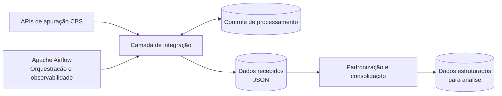

# CBS API Data Pipeline
### Engenharia de dados para a Reforma Tributária Brasileira

**Portfólio técnico | Python · Apache Airflow · Docker · REST APIs · ETL**

[English version](README.en.md) · [Arquitetura técnica](docs/arquitetura.md)

> Este repositório apresenta a arquitetura, as tecnologias e os principais aspectos de engenharia da solução. A versão utilizada em produção é mantida em um repositório privado por conter dados sensíveis.

## Visão geral

O **CBS API Data Pipeline** é uma solução de engenharia de dados voltada à integração com serviços de apuração da Contribuição sobre Bens e Serviços (CBS), no contexto da Reforma Tributária brasileira.

O desafio é transformar a obtenção de dados fiscais por APIs assíncronas em um processo **rastreável, recuperável e preparado para análise**, considerando dependências externas, diferentes estados de processamento e a necessidade de preservar a integridade das informações recebidas.

## Arquitetura em alto nível

## Competências demonstradas

| Pilar | Aplicação no projeto |
| --- | --- |
| **Integração de APIs** | Coleta de dados em serviços com processamento assíncrono |
| **Orquestração** | Organização e acompanhamento dos fluxos com Apache Airflow |
| **Resiliência** | Continuidade de processamento e tratamento controlado de falhas |
| **Engenharia de dados** | Preservação do dado de origem e preparação de saídas estruturadas |
| **Rastreabilidade** | Identificação de etapas, resultados e pontos de atenção do processamento |
| **Ambiente reproduzível** | Separação de componentes e dependências com Docker |
| **Qualidade** | Validação por testes com cenários e dados simulados |

## Tecnologias

**Python** · **Apache Airflow** · **Docker / Docker Compose** · **PostgreSQL** · **SQLite** · **pandas** · **HTTP/REST** · **JSON / CSV** · **GitHub Actions**

## Escopo e evolução

A solução contempla a coleta, o acompanhamento e a preparação de informações relacionadas à apuração CBS, incluindo cenários de débitos e créditos.

## Documentação

- [Arquitetura e responsabilidades dos componentes](docs/arquitetura.md)
- [English overview](README.en.md)

## Sobre

Projeto de portfólio de **Abimael Brilhante**, com foco em engenharia de dados, integração de sistemas, automação e domínio de processos fiscais.

**Perfil técnico:** [GitHub — AbimaelBrilhante](https://github.com/AbimaelBrilhante).
