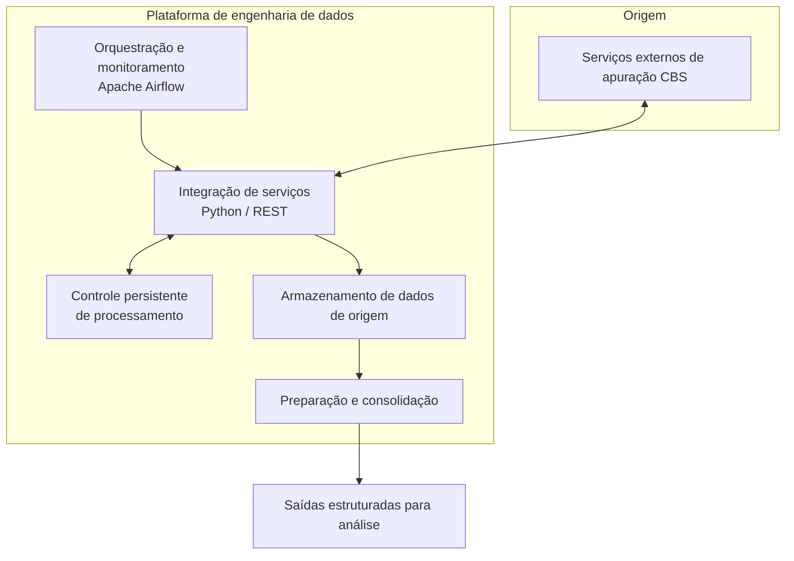

# Arquitetura técnica — CBS API Data Pipeline

[Voltar à apresentação](../README.md)

## Objetivo de engenharia

Organizar a obtenção de dados de apuração CBS por serviços externos, com etapas observáveis de integração, acompanhamento e preparação de dados para consumo analítico.

O projeto considera três necessidades centrais: **continuidade de processamento**, **integridade do histórico recebido** e **visibilidade operacional**.

## Visão dos componentes

Diagrama ilustrativo, limitado às responsabilidades arquiteturais. Não reproduz configurações, regras internas nem sequências detalhadas do código.

## Responsabilidades por camada

| Camada | Objetivo | Considerações de engenharia |
| --- | --- | --- |
| **Origem externa** | Disponibilizar informações de apuração | Dependência de disponibilidade e autorização do serviço |
| **Integração** | Interagir com APIs e receber respostas | Validação de respostas e isolamento da integração |
| **Orquestração** | Coordenar etapas e acompanhar execuções | Observabilidade, dependências e diagnóstico |
| **Controle de estado** | Registrar o progresso dos processos | Recuperação e consistência do acompanhamento |
| **Persistência de origem** | Preservar dados recebidos | Rastreabilidade e conferência posterior |
| **Preparação de dados** | Organizar informações para análise | Padronização, consistência e histórico |
| **Consumo analítico** | Disponibilizar extratos estruturados | Integração futura com plataformas analíticas |

## Princípios de qualidade

**Resiliência.** Interrupções e resultados não conclusivos precisam ser distinguíveis de processamento concluído, com visibilidade para análise operacional.

**Integridade.** Os dados recebidos devem ser preservados de modo a viabilizar verificações e rastreabilidade entre origem e saída estruturada.

**Separação de responsabilidades.** Integração, orquestração, armazenamento e transformação representam preocupações diferentes e podem evoluir com menor acoplamento.

**Testabilidade.** Os comportamentos críticos podem ser avaliados com cenários sintéticos, sem depender de credenciais ou dados fiscais reais durante os testes.

**Segurança e privacidade.** Segredos, dados de empresas, registros fiscais e detalhes internos de operação não são publicados.

## Limites desta apresentação

Este repositório contém somente material de arquitetura e apresentação profissional. Não disponibiliza:

- Código-fonte, DAGs, scripts ou definições de infraestrutura;
- Parâmetros internos de acesso, autenticação ou recuperação;
- Credenciais, arquivos operacionais ou dados de contribuintes;
- Configurações, testes executáveis ou dependências instaláveis.

O escopo descrito é técnico e demonstrativo. A implementação operacional é mantida separadamente em repositório privado. A disponibilidade e os contratos dos serviços externos devem ser confirmados pelos seus provedores.

---

*Projeto de portfólio independente de Abimael Brilhante; sem vínculo oficial com a Receita Federal ou o SERPRO.*
